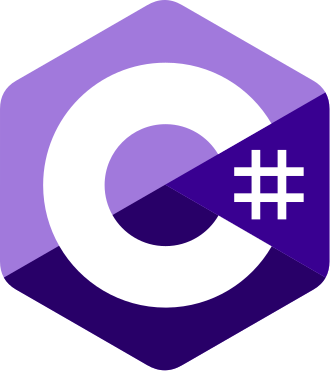

# Financial-Modeling

This repository is concerned with the study of risk management in the financial marketplace, using a specialized, multi-engine approach across SAS, C#, and Enterprise SQL.

Successful inquiry in the social sciences presents many challenges because of the vagaries of the subject matter. A normative economic model inevitably requires that some assumptions are made; after all, the end product is an abstraction of how market participants interact. In the classroom, we often rely on well-behaved databases like CRSP and Compustat to understand how the financial world ought to operate.

This repository, however, branches heavily out into "the wild."

To equip the modern analyst to survive non-cooperative data ecosystems, un-sanitized regulatory disclosures, and messy real-world market constraints, the curriculum is organized into three distinct computational pillars:

---

###  &nbsp; The SAS Pillar
For enterprise-grade risk compliance analytics, time-series operations, and historical institutional data validation. This ecosystem focuses on building core schema manipulation, table engineering, and abstract financial concept validation.

###  &nbsp; The C# Pillar
For building high-throughput, multi-threaded extraction engines (ETL), handling raw XML/HTML data streaming, and managing automated pipeline reliability. This system handles the heavy programmatic engineering required to ingest data from raw corporate filings.

###  &nbsp; The SQL Pillar
For industrial, production-grade relational database management. This environment covers parameterized, high-performance querying, structural key mutations, and transaction logic designed to manage data far beyond the boundaries of basic classroom procedures.

---

The end-user is expected to have a grasp of basic statistical analysis, some familiarity with Microsoft Excel, as well as institutional financial data platforms such as Bloomberg Terminal or LSEG Workspace (formerly Reuters). No prior programming experience is required.

The first series of exercises explores financial concepts at an abstract level. The subsequent sections involve the discussion, analysis, development, and algorithmic engineering of models based on aggressive data-mining techniques of un-sanitized, real-world financial reports.
